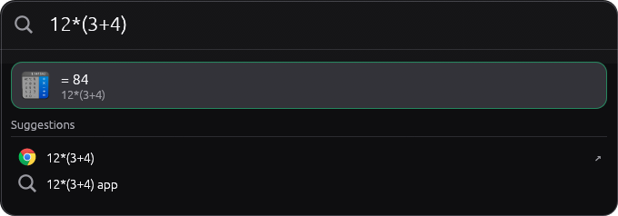

<div align="center">


# Glint

**Spotlight-style search launcher for the Linux desktop**

[](https://github.com/PedroC2892/Glint/actions/workflows/ci.yml)
[](https://github.com/PedroC2892/Glint/releases)
[](LICENSE)
[](#platform-support)

</div>

---



## Why Glint

- **Instant open**: Summons in ~25 ms on X11 with the resident instance (a cold start used to take ~2,000 ms on a hybrid-GPU laptop). On Wayland the window is recreated on each open, which takes ~160–240 ms. Client dispatch completes and exits in ~6 ms.
- **Zero idle overhead**: Consumes 0% CPU while hidden by sleeping in a blocking Unix socket `accept` call.
- **No discrete GPU wake-up**: Uses the OpenGL (`glow`) backend so laptops with hybrid GPUs keep their discrete GPU powered down, avoiding Vulkan ICD device enumeration delays.
- **Privacy by design**: Searches files and applications strictly locally. No tracking, telemetry, or background reporting. Unix domain sockets are protected with strict user-only permissions (`0700` directory, `0600` socket).
- **Keyboard-first**: Designed for continuous typing and immediate access via `Win + Space`.

## Features

- **Applications & Settings**: Instantly finds installed applications and system settings panels (GNOME and KDE) through freedesktop `.desktop` entries with native icons.
- **Files & Folders**: Indexes user home directories in the background, categorizing results into Documents, Folders, Images, Music, Movies, and Other Files with last-modified dates.
- **Top Hit**: Highlights the most relevant match first, with adaptive ranking based on past access.
- **Calculator**: Evaluates math expressions inline: `12*(3+4)`, `2^10`, `sqrt(2)`, `2pi`, `sin(1)`.
- **Unit Conversions**: Converts length, mass, volume, time, digital storage, speed, area, and temperature: `10 km to mi`, `100 f in c`, `5 ft`.
- **Currency Conversions**: Real-time conversions using daily exchange tables: `100 usd to eur`, `$20`, `€15 in gbp`.
- **Definitions**: English dictionary definitions via Wiktionary and the Free Dictionary API.
- **Web Search**: Fallback to browser search or query suggestions on DuckDuckGo.
- **Preview Panel**: Side preview toggleable via `Ctrl+Y` displaying file metadata, syntax snippets, or image previews.
- **System Themes**: Resolves system icon themes across KDE and GNOME, following the freedesktop `Inherits` chain to `hicolor`, and matches MIME types using the shared-mime-info database.

## Keyboard Shortcuts

| Shortcut | Action |
| --- | --- |
| `↑` / `↓`, `Tab` | Navigate results |
| `Ctrl+↑` / `Ctrl+↓` | Jump between sections |
| `Enter` | Open selection / Copy calculator or conversion result |
| `Ctrl+Enter`, `Ctrl+R` | Open containing directory in file manager |
| `Ctrl+C` | Copy selected result, name, or path to clipboard |
| `Ctrl+B` | Perform web search |
| `Ctrl+L` | Jump directly to definition result |
| `Ctrl+Y` | Toggle preview side panel |
| `Ctrl+,` | Open or close settings |
| `Esc` | Clear query; press again to close window |

Clicking outside the search window or switching focus to another application closes Glint.

## Installation

### Debian / Ubuntu (`.deb` Package)

Prebuilt `.deb` packages for Debian 12+ and Ubuntu 22.04+ are available on the [Releases](https://github.com/PedroC2892/Glint/releases) page:

```sh
sudo apt install ./glint_0.2.0-1_amd64.deb
```

To remove:
```sh
sudo apt remove glint
```

### From Source

Requires a working Rust toolchain (edition 2024).

```sh
./install.sh
```

`install.sh` builds Glint with the fast `local` profile, copies the binary to `~/.local/bin/glint`, installs the desktop launcher and icon suite to `~/.local/share`, creates an autostart daemon entry in `~/.config/autostart/glint.desktop`, and starts the background daemon. No root permissions are required.

To uninstall:
```sh
./install.sh --uninstall
```

## Shortcut Setup (Win + Space)

Summoning Glint with `Win + Space` (Super + Space):

1. **KDE Plasma**: Handled automatically through `X-KDE-Shortcuts=Meta+Space` in the desktop launcher.
2. **GNOME**: Configured automatically by `install.sh`. To configure manually:
   ```sh
   SCHEMA="org.gnome.settings-daemon.plugins.media-keys"
   PATH_ENTRY="/org/gnome/settings-daemon/plugins/media-keys/custom-keybindings/glint/"
   CURRENT=$(gsettings get "$SCHEMA" custom-keybindings 2>/dev/null || echo "@as []")
   if [ "$CURRENT" = "@as []" ] || [ "$CURRENT" = "[]" ]; then
       gsettings set "$SCHEMA" custom-keybindings "['$PATH_ENTRY']"
   else
       gsettings set "$SCHEMA" custom-keybindings "$(echo "$CURRENT" | sed "s/]/, '$PATH_ENTRY']/")"
   fi
   BIND_SCHEMA="org.gnome.settings-daemon.plugins.media-keys.custom-keybinding:$PATH_ENTRY"
   gsettings set "$BIND_SCHEMA" name "Glint"
   gsettings set "$BIND_SCHEMA" command "glint"
   gsettings set "$BIND_SCHEMA" binding "<Super>space"
   ```
3. **Xfce**: Go to *Settings → Keyboard → Application Shortcuts*, add command `glint` with shortcut `Super+Space`.
4. **i3 / Sway**: Add the following line to your window manager configuration:
   ```
   bindsym $mod+space exec glint
   ```

## Usage & CLI Options

```
glint [--query TEXT] [--settings] [--daemon] [--no-daemon] [--quit]
      [--screenshot FILE.png [--keys Down,Right,...]]
```

- `glint` – summon or focus the running daemon; launches a daemon if one is not active.
- `glint --daemon` – start as a resident background daemon (starts hidden, creates IPC socket).
- `glint --no-daemon` – run standalone without IPC daemon support.
- `glint --quit` – signal the running daemon to shut down cleanly.
- `glint --query "TEXT"` – open the search launcher with an initial query pre-typed.
- `glint --settings` – open directly to the settings interface.
- `glint --screenshot FILE.png` – render ~120 frames without taking keyboard focus, write the window contents to a PNG file, and exit (used for visual testing).
- `glint --keys "Down,Down,Enter"` – simulate keyboard input during screenshot mode.

## Configuration

Settings are saved in `$XDG_CONFIG_HOME/glint/config.json` (defaults to `~/.config/glint/config.json`).

- **General**: Toggle background resident mode (`keep_running`: opens instantly while resident in memory; off: starts on demand and frees its memory when closed).
- **Appearance**: Accent color palettes, custom hex colors, and window background opacity (requires an active desktop compositor).
- **Files**: Toggle indexing of hidden files, configure additional search directories, or exclude directory patterns via `skip_dirs`.
- **Search**: Toggle online definitions and currency updates.
- **Protected Paths**: Sensitive directories (`.ssh`, `.gnupg`, `.password-store`, `.pki`, `.git`, `.cache`, keyring folders, and Trash) are permanently excluded from file indexing, and hidden files are never previewed.

## Privacy & Security

- **Local Processing**: Queries, file paths, and application indexes remain exclusively on your local machine.
- **Online Lookups**:
  - Currency conversion fetches a public exchange rate table from [open.er-api.com](https://open.er-api.com) over HTTPS. Your search queries are never sent.
  - Definitions fetch data from the [Free Dictionary API](https://dictionaryapi.dev) only when the definition result row is explicitly selected, never during typing.
  - Online features can be disabled in Settings.
- **Socket Hardening**: The daemon creates its IPC Unix domain socket in `$XDG_RUNTIME_DIR/glint/glint.sock`. The socket directory is enforced with `0700` permissions (owner-only access) and the socket file with `0600` permissions. The socket is cleanly deleted upon daemon shutdown.
- **History**: Ranking history is stored locally in `$XDG_DATA_HOME/glint/history.tsv` (`~/.local/share/glint/history.tsv`).

## Performance

| Metric | Resident Daemon | Cold Start |
| --- | --- | --- |
| Summon latency (X11) | ~25 ms | ~2,000 ms before 0.2 (~280 ms now) |
| Summon latency (Wayland) | ~160–240 ms | ~280 ms |
| Client Exit Time | ~6 ms | N/A |
| Idle CPU Usage | 0.0% (blocking `accept`) | N/A |
| dGPU Activation | None (OpenGL glow) | None (OpenGL glow) |
| Search latency (~150k files) | a few tens of ms (allocation-free scoring) | same |

## Architecture

| Module | Source | Description |
| --- | --- | --- |
| Entry Point | [src/main.rs](src/main.rs) | CLI options, daemon orchestration, and client dispatch |
| IPC | [src/ipc.rs](src/ipc.rs) | Unix domain socket communication and protocol framing |
| UI & Event Loop | [src/ui.rs](src/ui.rs) | eframe application state, query dispatch, and key bindings |
| Rendering | [src/draw.rs](src/draw.rs) | egui layout drawing, results list, and preview cards |
| Indexer | [src/index.rs](src/index.rs) | Desktop applications, home directory walking, and MRU history |
| Configuration | [src/config.rs](src/config.rs) | Settings schema, defaults, and JSON serialization |
| Icons | [src/icons.rs](src/icons.rs) | Freedesktop theme traversal, MIME resolution, and cache |
| Calculator | [src/calc.rs](src/calc.rs) | Math parsing, unit conversion, and currency exchange rates |
| Launcher | [src/open.rs](src/open.rs) | Process spawning, file open handlers, and HTTP requests |
| Focus | [src/x11focus.rs](src/x11focus.rs) | Active window focus management on X11 |

### IPC & Daemon Flow

When `glint` is summoned without flags, a client process connects to the daemon Unix socket at `$XDG_RUNTIME_DIR/glint/glint.sock`. If no instance is listening, that process becomes the resident instance itself. The client sends a summon command with any initial query string and exits immediately (~6 ms). The daemon wakes from its blocking socket accept, updates the query state, and makes the pre-warmed window visible within ~25 ms. Closing or unfocusing the window hides it while keeping internal caches warm, dropping CPU usage back to 0%.

## Building & Testing

```sh
# Build local incremental profile
cargo build --profile local

# Build optimized release binary
cargo build --release

# Run automated tests
cargo test

# Run Clippy checks
cargo clippy --all-targets -- -D warnings

# Build Debian package
cargo deb
```

## Platform Support

Developed and tested on Linux with KDE Plasma and GNOME on both X11 and Wayland. Under X11, Glint requests keyboard focus using window manager hints similar to system panels, ensuring focus even when focus-stealing prevention is enabled.

## Contributing

Contributions are welcome. Please ensure that `cargo test` and `cargo clippy --all-targets -- -D warnings` pass before submitting pull requests. Contributions are accepted under the same license.

## License

Glint is free software, licensed under the GNU General Public License v3.0 or later. See [LICENSE](LICENSE).
